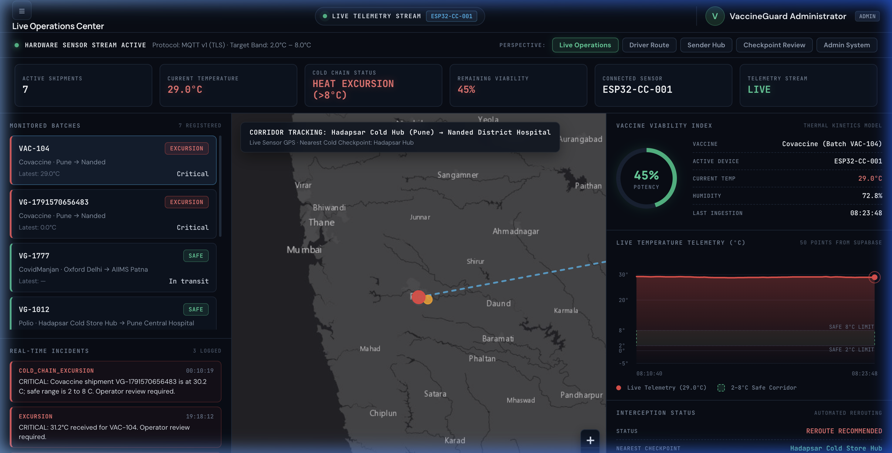
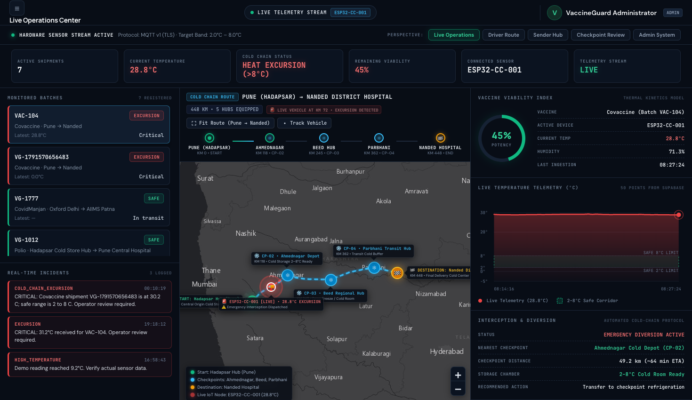
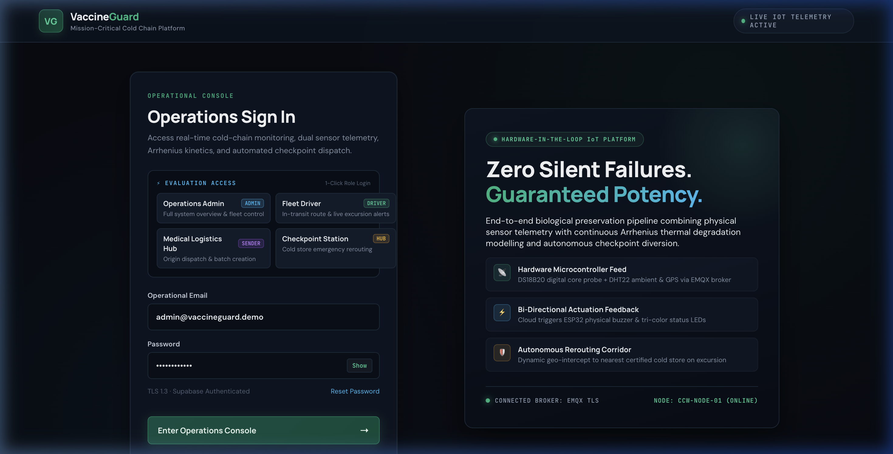

# 🛡️ VaccineGuard 2.0 (Fusion 2026 Cold Chain)
### Mission-Critical Real-Time Biological Integrity & Logistics Preservation Platform

[](https://espressif.com)
[](https://www.emqx.com/cloud)
[](https://supabase.com)
[](https://supabase.com/docs/guides/realtime)
[](https://www.who.int)
[](LICENSE)

---

## 📌 Executive Summary

Biological pharmaceuticals (mRNA vaccines, insulin, antivenoms, and live-attenuated vaccines) require a continuous, strictly controlled thermal environment between **+2°C and +8°C** from point of manufacture to point of administration. 

### The Challenge: "Silent Failures"
Conventional supply chains rely on passive, retrospective USB dataloggers. When thermal insulation fails or transit vehicles experience delays:
- Excursions are discovered **only after delivery** at the clinic.
- Doses may appear visually intact despite losing all biochemical efficacy.
- Thousands of doses are discarded, or worse, administered with zero immune response.

### The VaccineGuard 2.0 Solution
**VaccineGuard 2.0** is an integrated hardware-software platform designed to eliminate silent failures:
1. **Physical Core & Ambient Dual Sensing:** Real-time dual probes (DS18B20 liquid/core simulator + DHT22 ambient container environment) coupled with live GPS tracking.
2. **Kinetic Thermal Degradation Modeling:** Continuous calculation of thermal stress curves and remaining viable shelf life via Arrhenius reaction kinetics.
3. **Autonomous Logistics Interception:** Automated mathematical geofencing (Haversine corridor analysis) dynamically recalculates and diverts compromised transit fleets to the nearest certified cold store hub along the transit route.
4. **Bi-Directional Cloud Actuation:** When temperature excursions occur, cloud systems publish instant feedback over MQTT to trigger physical buzzers and visual warning LEDs on the in-transit ESP32 node.

---

## 📸 Platform Interface & Screenshots

### 🖥️ Operations Center & Live Telemetry Dashboard
*Real-time thermal monitoring, dual core/ambient telemetry meters, viability curves, and automated alert queues.*


### 🗺️ Standardized Logistics Corridor (Pune ➔ Nanded Express Route)
*448 km mission route with active waypoint nodes, certified cold-chain buffer depots, and dynamic emergency intercept vectors.*


### ⚡ Operations Sign-In with 1-Click Evaluation Access
*Role-based workspaces designed for high-stress operations with instant role switching for judges and evaluators.*


---

## 🏛️ System Architecture

```
  +-------------------------------------------------------------------------+
  |                        1. HARDWARE IoT SENSING                          |
  |  [DS18B20 Core Probe] + [DHT22 Ambient] + [GPS Neo-6M] --> [ESP32 Node]  |
  +------------------------------------+------------------------------------+
                                       | TLS 8883 (MQTTS)
                                       v
  +-------------------------------------------------------------------------+
  |                        2. EMQX CLOUD MQTT BROKER                        |
  |             coldchain/v1/shipments/<shipment_id>/telemetry              |
  |             coldchain/v1/shipments/<shipment_id>/commands               |
  +------------------------------------+------------------------------------+
                                       |
                                       v
  +-------------------------------------------------------------------------+
  |                     3. BACKEND WORKER & KINETICS                        |
  |   - Python asyncio daemon with Paho-MQTT                                |
  |   - Validates ranges, calculates excursion severity                     |
  |   - Triggers bi-directional physical buzzer commands on warning/danger |
  |   - Autonomous nearest-checkpoint dispatcher via Haversine distance     |
  +------------------------------------+------------------------------------+
                                       |
                                       v
  +-------------------------------------------------------------------------+
  |                     4. SUPABASE REALTIME CLOUD DB                       |
  |   - PostgreSQL with strict Row Level Security (RLS)                     |
  |   - Realtime WebSocket publication: shipments, telemetry, alerts        |
  |   - Stored procedures: receive_shipment(), admin_delete_shipment()      |
  +------------------------------------+------------------------------------+
                                       |
                                       v
  +-------------------------------------------------------------------------+
  |                 5. MISSION CONTROL FRONTEND DASHBOARDS                  |
  |   - Zero-dependency Vanilla JS & CSS design system                      |
  |   - Live Leaflet map with Pune -> Nanded Logistics Corridor             |
  |   - 1-Click Role-Based Quick Access:                                    |
  |     * Operations Admin    * Fleet Transporter                           |
  |     * Logistics Hub       * Checkpoint Station Manager                  |
  +-------------------------------------------------------------------------+
```

---

## 🗺️ Standardized Logistics Corridor: Pune ➔ Nanded

The platform features a standardized 448 km mission corridor traversing Maharashtra (NH-61 / NH-65), complete with real-time waypoint tracking and cold-chain buffer stops:

| Stop ID | Hub Name | Type | Location (Lat, Lng) | KM Marker | Cold Storage Facilities |
|---|---|---|---|---|---|
| **CP-01** | **Hadapsar Cold Store Hub** | **ORIGIN** | 18.5018, 73.9357 | **KM 0** | Deep Freeze & Buffer Cold Room |
| **CP-02** | **Ahmednagar Cold Depot** | Transit Hub | 19.0952, 74.7496 | **KM 118** | 2°C – 8°C Certified Depot |
| **CP-03** | **Beed Regional Vaccine Hub** | Emergency Divert | 18.9894, 75.7601 | **KM 245** | Cryo-Stabilization Facility |
| **CP-04** | **Parbhani Transit Cold Hub** | Transit Buffer | 19.2612, 76.7749 | **KM 362** | Transit Cold Buffer Station |
| **CP-05** | **Nanded District Hospital** | **DESTINATION** | 19.1383, 77.3210 | **KM 448** | Central Regional Medical Depot |

When an excursion is detected along the highway, the nearest active cold facility is automatically assigned, alerting the checkpoint operator and updating the driver's diversion vector in real time.

---

## 🔑 Key Features

- **⚡ Sub-Second Live Telemetry:** Streaming sensor readings over secure MQTT TLS into Supabase Realtime with immediate dashboard reflection.
- **🛡️ Bi-Directional Actuation Feedback:** Cloud issues buzzer commands back to the physical device when temperature exceeds critical limits.
- **👥 Role-Based Access Control (RBAC):**
  - **Administrator:** Full fleet overview, system telemetry, alert management, and user provisioning.
  - **Fleet Transporter:** Route map navigation, real-time cargo temperature indicators, excursion warnings.
  - **Medical Logistics Hub:** Batch dispatching, shipment creation, receiver designation, and payload validation.
  - **Checkpoint Operator:** Emergency diversion alerts, cold storage transfer acceptance, and status acknowledgment.
- **📊 Arrhenius Degradation Kinetics:** Dynamic viability calculation translating cumulative thermal excursions (°C·min) into actual potency retention.
- **🎨 Modern Dark Glassmorphic UI:** High-contrast, clean, responsive dashboard designed for high-stress operations centers with zero external heavy frameworks.

---

## 📂 Project Structure

```
Fusion2026_Cold_Chain/
├── frontend/                     # Pure Vanilla JS & CSS Web Application
│   ├── index.html                # Live Operations Center Dashboard
│   ├── login.html                # Operations Sign-In with 1-Click Evaluation Access
│   └── assets/
│       ├── css/
│       │   ├── styles.css        # Core design tokens, dark glassmorphic system
│       │   ├── login.css         # Sign-in split screen & evaluation grid styling
│       │   └── role-dashboards.css # Dedicated role-specific console styles
│       └── js/
│           ├── config.js         # Runtime Supabase & API endpoints configuration
│           ├── supabase-auth.js  # Supabase JS CDN wrapper & auth helpers
│           ├── auth.js           # Login controller & 1-click evaluator listeners
│           ├── app.js            # Main Operations Center & Leaflet map engine
│           └── role-dashboards.js# Role views (Admin, Driver, Sender, Checkpoint)
│
├── backend/                      # IoT Ingestion & Actuation Daemon
│   ├── mqtt_worker.py            # Async MQTT subscriber, Haversine dispatcher & buzzer
│   ├── .env                      # MQTT broker credentials & Supabase secret key
│   └── emqx-ca.crt               # EMQX Cloud TLS Certificate Authority
│
├── supabase/                     # Database Migrations & Edge Functions
│   ├── supabase_new_project_setup.sql # 1-Click master migration & seed script
│   ├── migrations/               # Incremental schema evolution scripts
│   └── functions/admin-users/    # Supabase Deno Edge Function for user admin
│
├── scripts/                      # Developer & Evaluation Automation
│   └── setup_new_supabase.py     # 1-Command demo user & profile provisioning
│
├── docs/                         # Technical Specs & Architecture Diagrams
│   ├── HARDWARE_LIVE_FEED.md     # MQTT telemetry payload specification
│   └── vaccineguard-layered-architecture.svg # Architecture diagram
│
├── .gitignore                    # Production git hygiene rules
└── README.md                     # Comprehensive platform documentation
```

---

## 🚀 Quickstart & Setup Guide

### 1. Prerequisites
- **Python 3.10+**
- Modern Web Browser (Chrome, Firefox, Safari, Edge)
- Free [Supabase](https://supabase.com) account

---

### 2. Database Setup (1-Click SQL)
1. In your Supabase Dashboard, navigate to **SQL Editor** $\rightarrow$ **New Query**.
2. Copy and paste the entire contents of [`supabase/supabase_new_project_setup.sql`](supabase/supabase_new_project_setup.sql).
3. Click **Run**.
   *This automatically creates all database tables (`checkpoints`, `profiles`, `shipments`, `telemetry_readings`, `alerts`), configures Row-Level Security, enables Realtime subscriptions, and seeds the Pune ➔ Nanded corridor.*

---

### 3. Demo User Provisioning (1-Command)
Provision the 4 evaluation role accounts with standard evaluation credentials:

```bash
# Run with your Supabase Project URL and Service Role Secret:
python3 scripts/setup_new_supabase.py --url "https://<YOUR_PROJECT>.supabase.co" --secret "<YOUR_SERVICE_ROLE_KEY>"
```

This provisions:
- `admin@vaccineguard.demo` (Password: `Password@123`)
- `driver@vaccineguard.demo` (Password: `Password@123`)
- `sender@vaccineguard.demo` (Password: `Password@123`)
- `checkpoint@vaccineguard.demo` (Password: `Password@123`)

---

### 4. Configuration
Update [`frontend/assets/js/config.js`](frontend/assets/js/config.js):
```javascript
window.VG_CONFIG = Object.freeze({
  API_BASE_URL: '',
  SUPABASE_URL: 'https://<YOUR_PROJECT>.supabase.co',
  SUPABASE_PUBLISHABLE_KEY: '<YOUR_ANON_KEY>',
  DEMO_MODE: false,
  POLL_INTERVAL_MS: 3000
});
```

Update [`backend/.env`](backend/.env):
```env
MQTT_HOST=ta3aa281.ala.asia-southeast1.emqxsl.com
MQTT_PORT=8883
MQTT_USERNAME=backend-worker
MQTT_PASSWORD=YourMqttPassword

SUPABASE_URL=https://<YOUR_PROJECT>.supabase.co
SUPABASE_SECRET_KEY=<YOUR_SERVICE_ROLE_KEY>
MQTT_CA_CERT=emqx-ca.crt
```

---

### 5. Running the Application

#### Start Local Frontend Server:
```bash
python3 -m http.server 8080 --directory frontend
```
Visit **[http://localhost:8080/login.html](http://localhost:8080/login.html)** in your browser.

#### Start Live IoT MQTT Ingestion Worker:
```bash
cd backend
python3 mqtt_worker.py
```

---

## 📡 Hardware Telemetry & Actuation Protocol

### Telemetry Uplink (ESP32 $\rightarrow$ Cloud)
**Topic:** `coldchain/v1/shipments/<shipment_id>/telemetry`  
**QoS:** 1 (At least once)  
**Payload Example:**
```json
{
  "shipment_id": "VAC-104",
  "device_id": "CCW-NODE-01",
  "ts": "2026-10-28T18:30:00Z",
  "temp_c": 4.5,
  "humidity_pct": 52.0,
  "lat": 18.8256,
  "lng": 74.3789,
  "source_mode": "hardware",
  "sensor_type": "DS18B20+DHT22"
}
```

### Actuation Downlink (Cloud $\rightarrow$ ESP32)
**Topic:** `coldchain/v1/shipments/<shipment_id>/commands`  
**Payload Example (Excursion Warning / Alarm):**
```json
{
  "command": "buzzer",
  "state": "on",
  "severity": "critical",
  "duration_seconds": 30
}
```

---

## 🧪 Evaluator 1-Click Access

For hackathon judges and evaluators, the login screen includes **1-Click Evaluation Access** cards:

| Role | Email | Password | Primary Console Capabilities |
|---|---|---|---|
| **Operations Admin** | `admin@vaccineguard.demo` | `Password@123` | Master operations room, corridor tracking, full audit logs |
| **Fleet Driver** | `driver@vaccineguard.demo` | `Password@123` | Route GPS stepper, live thermal HUD, nearest checkpoint alert |
| **Logistics Hub** | `sender@vaccineguard.demo` | `Password@123` | Origin batch dispatch, container assignment, receiver selection |
| **Checkpoint Station** | `checkpoint@vaccineguard.demo` | `Password@123` | Inbound emergency queue, cold box inspection, alert resolution |

---

## 📄 License & Attribution

Developed for **Fusion 2026 Hackathon**.  
Released under the [MIT License](LICENSE).
